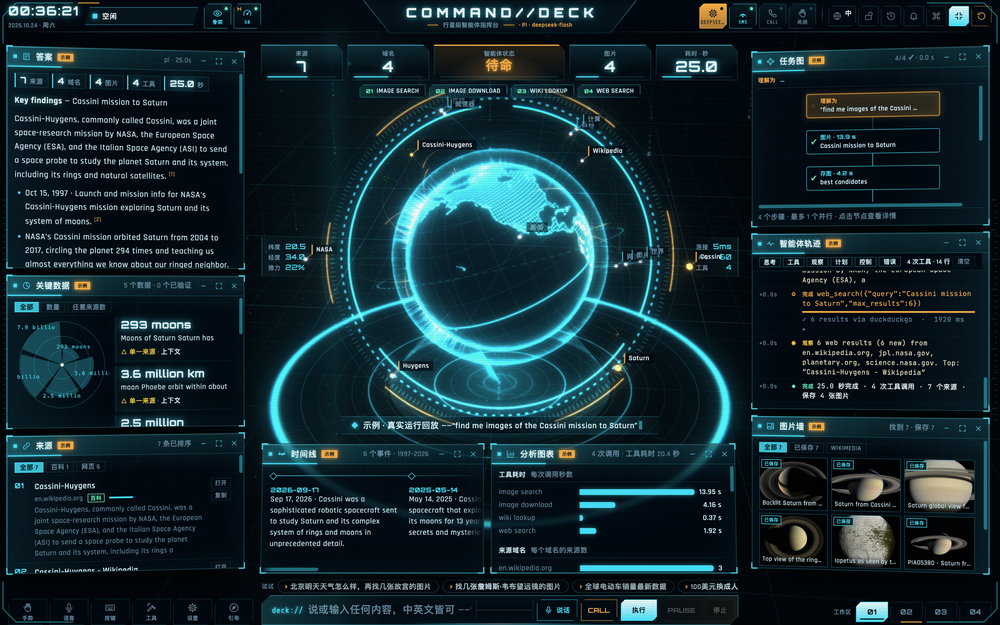
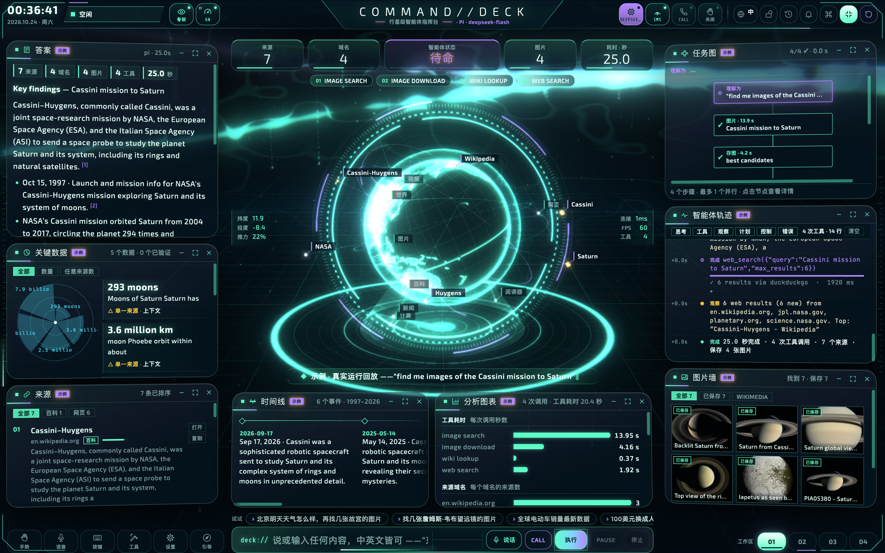
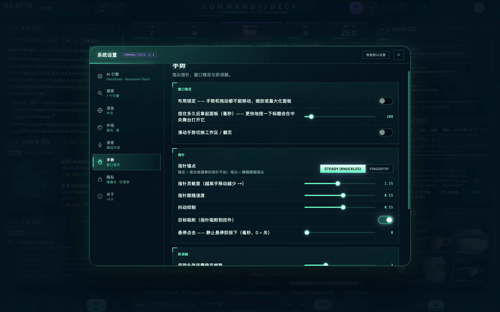
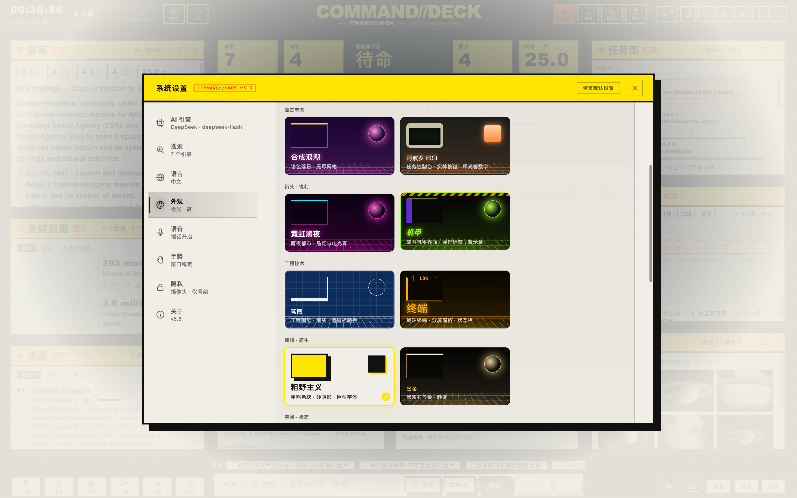
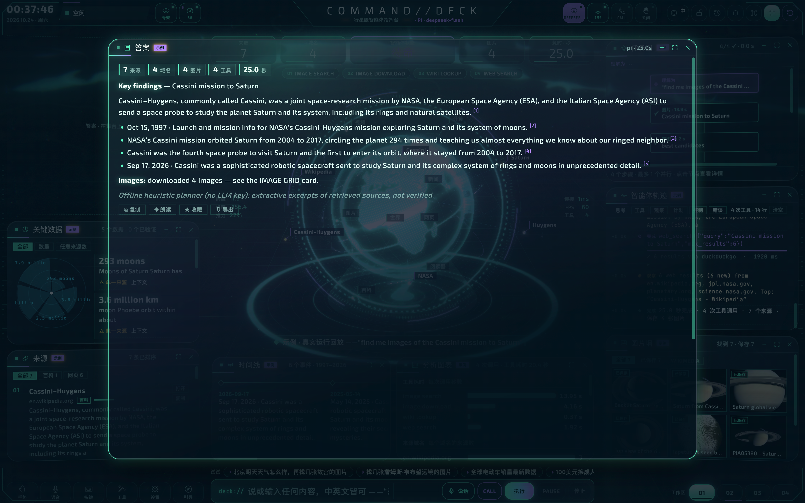

# COMMAND//DECK · DSH 指挥台插件

[简体中文](README.zh.md) | [English](README.md)

`dsh-plugin-command-deck` 是 DeepSeek Harness（DSH）的插件包（bundle）。它为 `dsh web` 加上四样东西：

| 模块 | 内容 |
|---|---|
| **启动动画** | 电影感开机序列：透视地面网格、旋转光环、解码 Logo、系统日志。注入 DSH 的 `index.html`，首帧即出现，DSH 就绪后退场，配色跟随所选设计语言。 |
| **指挥台面板** | 侧边栏 **指挥台** 里是完整的 3D 任务控制台：在指挥台里输入或说出的指令会在真实的 DSH 会话中运行，每一轮、流式思考、工具调用、工具结果和最终答案实时驱动指挥台；每个对话标题栏还有 **在指挥台中可视化** 按钮，把指挥台挂到该会话上。 |
| **DSH 皮肤** | 13 种设计语言重塑 DSH 自身（对话、侧边栏、输入框、菜单、对话框、设置）：轨道、极光、合成波、阿波罗 69、霓虹黑色、机甲、蓝图、终端、粗野主义、黑曜石、玻璃、面罩、极地。改变的不只是颜色，还有字体、圆角几何和焦点效果。可选 HUD 叠层提供四角括号、缓慢扫描线和暗角。 |
| **可视化控制台** | **设置 → 指挥台** 与 **插件** 页中本插件的页面：指挥台实时预览、按家族分组的主题画廊、启动控制、集成开关和动效控制。修改即时生效，保存在 DSH profile 里。 |

---

## 🤝 友情链接 / Friend Links

| 站点 Site | 链接 Link |
| :--- | :--- |
| 🤖 **Ai 资源网** | <https://human.rlybtd.com/> |

---

## 📸 截图

### 指挥台面板 · 3D 任务控制台





### 跟随会话 · 全息投影可视化



### DSH 皮肤 · 对话界面



### 可视化控制台 · 主题画廊



## 环境要求

- DeepSeek Harness `>= 0.2.0-rc.2 < 0.3`（在 `@deepseek-ai/dsh` 0.2.0-rc.2 的 `dsh web` 上实测；桌面版共用同一运行时，标题栏安全区按 36px 模拟验证）
- Node.js `>= 22.19.0`（DSH 自身要求）
- 3D 指挥台需要支持 WebGL 2 的浏览器；插件其他部分没有此要求

## 安装 / 升级 / 卸载

```bash
# 安装到某个 profile（`dsh web` 用的通常是 web，桌面端是 desktop）
dsh plugin --profile web add /绝对路径/dsh-plugin-command-deck-1.0.1.tgz

# 然后照常启动
dsh web
```

`dsh plugin` 会在 profile 目录里转交给 pnpm，所以 `.tgz` 请用**绝对路径**（或 `file:` 形式）。不需要额外的服务器、端口或 API Key：指挥台由 DSH 自己的 Web 服务挂在 `/command-deck/` 下，受 DSH 登录保护。

- **升级**：用新版本 tgz 再执行一次同样的 `add`。
- **卸载**：`dsh plugin --profile web remove dsh-plugin-command-deck`，或在 **插件** 页点 **卸载**；也可以只关掉开关而不卸载。
- **改动何时生效**：宿主半边（`lib/*`）在 DSH 启动时加载，改完源码必须重启一次 DSH。

## 使用说明

### 装好后你会看到的名字

- **插件页**（`插件 → 已安装`）里的名字是 **DSH指挥台UI-泥嚎糕手**；
- **侧边栏入口** 与 **设置 → 分区** 仍叫 **指挥台**（对应英文 `Command Deck`）。

### 1. 打开指挥台

点侧边栏 **指挥台**。在 DSH 里它**直接进入面板**：不再弹欢迎屏，也不会自动跑任何示例任务。首次打开会自动**跟随 DSH 当前正在看的那个会话**；如果你停在空白的新会话页，指挥台为空并列出全部会话。

### 2. 会话与消息

左栏最上面的 **会话 / SESSIONS** 卡片就是 DSH 自己的会话目录（实时刷新，含运行中脉冲）：

- 点一行 → 指挥台**跟随**该会话，并把它的对话**回放**成轨迹：`› 你`、计划、工具调用与结果、答复；
- 带 **DSH** 小标签的那一行 = DSH 界面上正在显示的会话；
- **新建** = 断开会话，下一条指令会在 DSH 侧新建一个；
- 切换会话会先清空再回放，两段对话不会混在一起；DSH 注入的上下文消息（`<system-reminder>`、运行时上下文）不会显示成你说的话；
- 会话在 DSH 里被归档/删除后，指挥台会提示并从列表里消失，不会对着空气发呆。

### 3. 退出与回来

- 顶栏最右的 **退出键** → 关闭指挥台面板，回到 DSH 的会话界面（侧边栏、会话列表都在）。
- **运行中退出不会中断 DSH 那一轮**；重新点回「指挥台」（或切视图、DSH 重渲染、整页刷新）会把整段轨迹**原样重建**，直播继续。
- 底栏 **视图 01–04** 是同一套界面的四个画布，切换时轨迹不会丢。

### 4. 在指挥台里下指令

命令栏（`deck://`）输入，或语音 / 通话模式。指令进入真实的 DSH 会话；运行中再输入会作为 **steer（引导）** 发给 DSH，**STOP** 取消本轮。

### 5. 调整外观

**设置 → 指挥台**（或 **插件 → DSH指挥台UI-泥嚎糕手**）：画廊里选一种设计语言，DSH 界面、指挥台、启动动画和 HUD 一起切换；在指挥台自己的设置里换主题，也会同步更新 DSH 皮肤。

## 项目说明

### 设置台：哪些归 DSH

在 DSH 里运行时，指挥台自带的这些页签不再自己管配置，而是显示「**由 DeepSeek Harness 托管**」和一个 **打开 DSH 设置** 按钮（真能拉起 DSH 自己的设置面板）：

| 页签 | 处理 |
|---|---|
| AI 引擎 | 模型与提供方归 DSH |
| 搜索 | 搜索提供方归 DSH |
| 语音 → 服务端转写 | 归 DSH；指挥台的通话仍用浏览器语音识别 |
| 关于 | 显示「智能体 DeepSeek Harness / AI 引擎 由 DSH 管理」，不再有框架切换开关 |
| 语言、外观、语音、手势、隐私 | 纯前端设置，照旧 |

DSH 内也不再向 `/api/llm`、`/api/search`、`/api/asr` 发探测请求（打开设置台时后端请求数为 0）。

### 皮肤的作用范围

皮肤与 HUD **只作用于 DSH 自身界面和指挥台**。一旦中心区换成**其他插件的面板**，皮肤与 HUD 会立刻暂停（`body[data-cdeck-skin-paused]`），那个页面拿到的样式与 DSH 原版完全一致——这是为了避免和其他插件页面的排版/字体冲突。回到会话或指挥台会自动恢复。

- 皮肤是一张真正的样式表 `/command-deck/skins.css`（同源、需 DSH 登录 Cookie，`no-cache`），不再塞进 `index.html` 的内联行；
- 不改变全局字号，不给标题加字距，焦点环只作用于可交互控件——这些都可能压坏第三方页面的固定行高布局；
- 指挥台面板贴合 DSH 中间栏（不再覆盖侧边栏和窗口标题栏），Windows 标题栏 / macOS 窗口 chrome 都有安全区。

### 控制台设置

所有设置即时生效，保存在 profile 的 `cordis.patch.yml` 的 `command-deck` 条目下，DSH 设置里点 **打开配置文件** 也能看到。

| 设置 | 默认 | 作用 |
|---|---|---|
| `theme` | `jarvis`（轨道） | 指挥台、DSH 皮肤、启动动画和 HUD 的设计语言 |
| `skin` | 开 | 重塑 DSH 界面；关闭后保持 DSH 原有的浅色/深色主题 |
| `hud` | 开 | HUD 叠层（从不拦截输入） |
| `boot` | `session` | 启动动画：`every` 每次启动、`session` 每个浏览器会话一次、`off` 关闭 |
| `bootStyle` | `cinematic` | `cinematic` 电影感（约 2.6 秒）或 `quick` 快速（约 1 秒） |
| `motion` | 100 | 动效强度 0–100（0 为静止） |
| `scanlines` | 开 | 指挥台和 HUD 的 CRT 扫描线 |
| `sound` | 开 | 指挥台音效（运行时合成，无音频文件） |
| `tilt` | 开 | 3D 座舱：两侧停靠区向你弯曲 |
| `brand` | 开 | 侧边栏中的 COMMAND//DECK 标识 |

系统开启「减少动态效果」时，启动动画和 HUD 停止动画。

### 快捷键（在 DSH 里）

`Ctrl/⌘K` 命令面板、`Esc` 关闭浮层/停止本轮、`/` 聚焦命令栏、`L` 切语言、`Shift+L` 锁布局、`H`/`G` 手势、`V`/`C`/`M` 语音、`1–4` 切视图、`T` 切主题、`Shift+F` 全屏、`R`/`Shift+R` 重置。

**不可用**：`S`（运行示例任务）与 `P`（暂停/继续）——DSH 里没有示例任务，也没有「暂停中的轮次」，帮助面板里这两行也会隐藏。

### 兼容性

下列各项均在真实的 `dsh web` 上验证过。会话 → 指挥台的事件翻译另有离线测试（源码中的 `node test/bridge.test.mjs`）。

| 范围 | 状态 |
|---|---|
| 首帧启动动画、就绪后交接、跳过、每次/每会话/关闭、电影感/快速 | ✅ |
| 侧边栏指挥台面板、全屏、键盘、鼠标、手势（摄像头）、语音与通话模式 | ✅ |
| 指挥台指令 → 新 DSH 会话 → 实时轮次（计划、流式正文与推理、工具调用/结果、耗时、最终答案、来源） | ✅ |
| 会话卡片：DSH 会话目录实时刷新、跟随、`DSH` 当前徽标、新建 | ✅ |
| 跟随已有会话 → **回放整段对话**（用户消息、计划、工具、答复），过滤 DSH 注入的上下文 | ✅ |
| 退出键回 DSH；重进 / 切视图 / 切页 / 整页刷新后轨迹原样恢复，运行中继续直播 | ✅ |
| 切换会话先清空再回放；会话被归档/删除时提示并断开 | ✅ |
| DSH 工具（web_search、web_fetch、bash/pwsh、read/write/edit、grep/glob、run_code、todo_write、present、团队工具…）路由到对应卡片 | ✅ |
| 设置台 AI/搜索/转写/关于 → 由 DSH 托管 + 打开 DSH 设置；DSH 内零后端探测请求 | ✅ |
| 皮肤：对话、侧边栏、输入框、气泡、菜单、对话框、设置、滚动条、焦点环、圆角与字体；浅色设计切浅色，深色设计保深色 | ✅ |
| **皮肤作用域**：其他插件面板上自动暂停，页面零样式注入 | ✅ |
| 设置页与插件页的控制台、实时预览、主题画廊、即时生效并持久化、恢复默认 | ✅ |
| 指挥台主题 ⇄ DSH 主题双向同步 | ✅ |
| 指挥台 **暂停/继续** | ➖ DSH 没有「暂停中的轮次」，指挥台会说明；请用引导或停止 |
| 智能体框架切换（Pi / OpenAI Agents / Hermes） | ➖ 在 DSH 中智能体就是 DSH 自己 |
| 关键数据、实体、时间线组件 | ➖ 只有结果带相应结构时才填充；DSH 工具多返回文本，这些面板常为空 |

### 隐私与安全

- 插件不保存任何密钥，自身不发起网络请求。指挥台只与父级 DSH 页面通信（同源、校验来源的 `postMessage`）；`/command-deck/` 下的所有请求都经过 DSH 自己的浏览器准入（没有登录 Cookie 返回 `401`），静态文件有路径穿越防护并设 `frame-ancestors 'self'`。
- 皮肤、HUD、启动动画只写入 DSH 自己的文档；其他插件面板上会被暂停，不会向它们的页面注入任何内容。
- 摄像头只在本机做手部骨架追踪：视频帧从不绘制到页面、从不上传，屏幕上只显示 21 个手部关键点及其连线。
- 模型、搜索、转写等凭据都保存在 DSH 的凭据存储中。

### 排错

- **装好后看不到入口**：重启 DSH，插件在启动时加载。
- **侧边栏名字没变**：侧边栏一直是「指挥台」；新名字只出现在 **插件页**。
- **指挥台显示 OFFLINE / 「无法连接 DeepSeek Harness」**：请从 DSH 内部打开指挥台（侧边栏或标题栏按钮），不要在新标签页直接打开 `/command-deck/`。
- **皮肤看起来「回退」了**：你当前停在别的插件面板上（皮肤按设计暂停），回到会话或指挥台即可恢复。
- **会话卡片是空的**：DSH 里还没有会话；发一条指令就会有一个。
- **「could not start a session」**：检查 DSH 是否有可用模型（设置 → 模型），指挥台会显示 DSH 自己的错误信息。
- **诊断**：DevTools 里 `__CDECK_BRIDGE__` 是实时桥接对象（`sessionId`、`log`、`lastError`），`__CDECK_BOOT__.play()` 可重放启动动画。

### 包结构

```
lib/index.js          宿主半边（Node）：设置 schema、index.html 注入、/command-deck/ 静态路由与 skins.css
lib/client.js         浏览器半边（DSH 客户端模块）：面板、标题栏按钮、会话桥、退出、控制台、标识
lib/boot.js           启动动画与 HUD（CSS、HTML 模板、早于插件的启动脚本）
lib/skins.js          13 种设计语言映射到 DSH 设计 token
deck/                 指挥台 Web 应用（嵌入式构建：?host=dsh）
deck/js/cards/sessions.js  会话卡片（DSH 会话目录 + 跟随）
deck/js/core/clipboard.js  剪贴板（iframe 内带 execCommand 兜底）
cordis.patch.yml      插件包补丁：挂载 `command-deck` 条目
```

### 更新记录

**1.0.1**

- 会话卡片与**消息回放**：跟随会话即回放它的对话；切换会话不混；会话被删/归档有提示；
- **退出键** 与回到指挥台后的轨迹恢复（运行中退出不中断 DSH 那一轮）；视图切换保留轨迹；
- 去掉全部**示例任务入口**，DSH 内不再自动弹欢迎屏；
- 设置台 AI/搜索/转写/关于 → **由 DSH 托管**，并停止后端探测请求；
- **皮肤作用域**：其他插件面板上自动暂停皮肤与 HUD；皮肤改为 `skins.css`，移除全局字号缩放与标题字距；
- 面板贴合 DSH 中间栏（含窗口标题栏安全区）；iframe 权限补齐弹窗/下载/剪贴板；
- 帮助里的工具清单换成 DSH 工具；快捷键隐藏 S/P；插件页名改为「DSH指挥台UI-泥嚎糕手」。

许可证：MIT（见 `LICENSE`）。第三方组件见 `THIRD_PARTY.md`。
